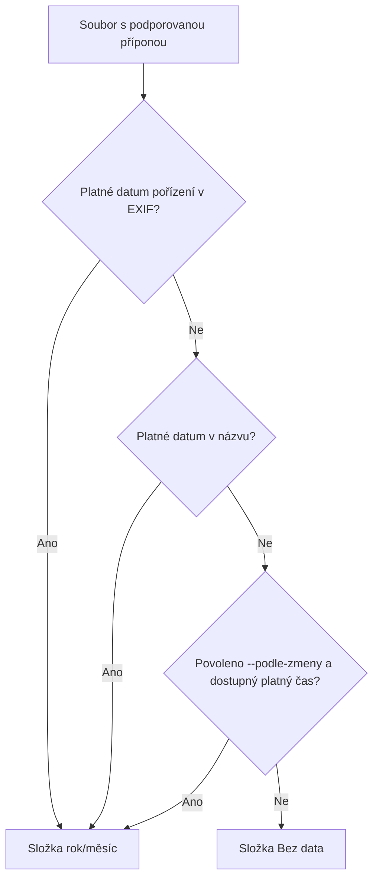

# Třídič fotek

Třídič projde složku včetně podsložek, najde obsahově shodné soubory a navrhne cílové cesty ve tvaru `rok/měsíc/název`. [Zdrojový kód hlavního algoritmu](planner.js#L129-L152)

## Algoritmus třídění

### 1. Určení data pořízení



EXIF se čte u JPEG, TIFF včetně CR2, PNG a WebP. Z názvu `IMG_20240814_123456.jpg` třídič získá datum `2024-08-14` a cílovou složku `2024/08`. [Čtení EXIF a data z názvu](exif.js#L96-L115)

### 2. Ověření duplicit

V každé skupině stejné velikosti se posuzují nejdřív soubory s datem z EXIF, pak s datem v názvu, časem změny a nakonec soubory bez data. Při stejném zdroji data rozhodne pořadí zdrojových cest.

```text
pro každou skupinu alespoň dvou souborů stejné velikosti:
    pro každý soubor v pořadí podle zdroje data:
        spočti SHA-256 vzorku ze začátku a konce souboru
        vyhledej dříve vybrané soubory se stejným otiskem
        porovnej s nimi všechny bajty v blocích po 1 MiB
        při úplné shodě označ soubor jako duplicitu
        pokud se soubor podařilo přečíst a nemá shodu, zapamatuj si jej
```

Vzorek obsahuje až 8 KiB z každého konce bez překryvu. Při chybě čtení se označí dotčený soubor a z neúplného porovnání se shoda nepotvrdí. [Vzorkování a porovnání obsahu v JavaScriptu](planner.js#L44-L105)

### 3. Sestavení cílových cest

Plán dává přednost jedinečným souborům a vybranému zástupci každé skupiny shodných souborů. Při kolizi v jedné složce přidá k názvu ` (2)`, ` (3)` a tak dál. Pokud při výchozím kopírování zástupce nejde přečíst, třídič zkusí ověřenou shodnou kopii pro stejnou cílovou cestu. [Přidělování názvů](planner.js#L107-L127), [ukládání kopií](disk.js#L71-L128)

## Spuštění

Stačí Node.js 22.17 nebo novější. Pro rychlou kontrolu použij `--prehled`. Vypíše počty souborů, shodných kopií a fotek bez data i počet plánovaných kopií pro každý měsíc. Kompletní plán je k dispozici ve výchozím formátu JSON nebo přes `--csv`.

```powershell
node tridic.js 'D:\Fotky' --prehled
node tridic.js 'D:\Fotky' --csv > plan.csv
node tridic.js 'D:\Fotky' --prehled --kopirovat 'D:\Výstup'
```

Volba `--kopirovat` ukládá kopie do nové podsložky `Roztříděné-…` v existujícím cíli mimo zdroj. U kopií zachovává časy poslední změny a přístupu. `--vcetne-shodnych` zahrne i všechny shodné kopie. `node tridic.js --help` zobrazí úplný seznam voleb.

Pokud se některou položku nepodaří přečíst nebo zkopírovat, třídič vypíše její cestu a pokračuje s ostatními. Návratový kód je `0` při úspěchu, `1` při chybě, která zastaví celý běh, a `2` při chybě u jednotlivé položky.

## Testy

`node --test` spustí testy se syntetickými metadaty a dočasnými soubory.
